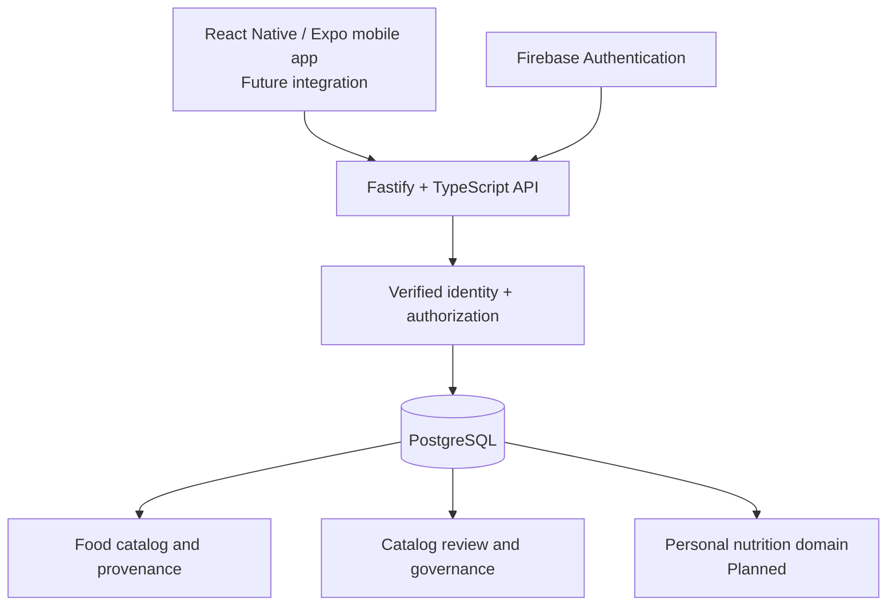

<div align="center">

# 🥗 NUTRASA
### Nutrisi Nusantara Apps

**Building a reliable foundation for an Indonesian nutrition-tracking application.**

Backend-first project • TypeScript • Fastify • PostgreSQL • Firebase Authentication • React Native / Expo


</div>

---

## 👋 About the Project

**NUTRASA (Nutrisi Nusantara Apps)** is an ongoing software engineering project to build a nutrition-tracking application with an emphasis on Indonesian foods. The planned experience covers food discovery, nutrition information, daily food logging, personal goals, and progress tracking.

Instead of presenting an interface powered only by mock data, the project currently prioritizes a **real, testable backend**: structured food data, authenticated identities, traceable sources, controlled publication, and reliable database operations.

> **Current state:** The database foundation and several security components have been implemented and tested. **NUTRASA is not yet a released or fully functional end-user application.** The React Native / Expo frontend is deferred until the required backend services and APIs are ready.

## 🎯 What I'm Building

| Area | Intended capability | Current status |
| --- | --- | --- |
| Food catalog | Structured food records, nutrients, servings, categories, aliases, and source provenance | **Database foundation implemented** |
| Identity | Firebase-based authentication and internal user identity mapping | **Backend adapter and unit tests implemented; live configuration pending** |
| Authorization | Restricted catalog capabilities with auditable grant/revoke | **Database integration tested** |
| Catalog quality | Reviews, digests, publication preflight, contributor lineage, and auditability | **Partially implemented; operational enforcement pending** |
| Personal nutrition | Food diary, goals, body-weight history, favorites, custom foods | **Planned** |
| Backend APIs | Real data access for food search, diary, dashboard, and user features | **Not yet complete** |
| Mobile app | React Native / Expo interface connected to actual backend APIs | **Deferred** |

## 🧰 Tech Stack

| Layer | Technology | Purpose |
| --- | --- | --- |
| Backend | **Node.js, TypeScript, Fastify** | Typed application services and HTTP API foundation |
| Database | **PostgreSQL 18** | Relational data, integrity constraints, transactional migrations, and security testing |
| Authentication | **Firebase Admin SDK** | Verified Firebase identity-token integration at the backend boundary |
| Mobile (planned) | **React Native, Expo** | Future mobile experience backed by real services |
| Engineering workflow | **Git, GitHub, PowerShell, automated tests** | Version control, repeatable integration checks, and quality gates |

## 🏗️ Architecture at a Glance



**Design principles:** explicit authorization, least-privilege database access, transactional integrity, fail-closed checks, traceable changes, modular implementation, and maintainability. The application backend is a **trusted identity boundary**; PostgreSQL does not independently authenticate the human behind a Firebase identity.

## ✅ Engineering Progress — Latest Checkpoint

**Repository branch:** `feat/database-foundation`  
**Milestone:** `M03-01 — Database & Catalog Governance`  
**Milestone state:** **PARTIAL / ACTIVE**

### Database migrations

| Migrations | Implemented scope | Evidence / status |
| --- | --- | --- |
| `0001`–`0002` | User identity foundation and food-source provenance | Previously validated |
| `0003`–`0005` | Food catalog, taxonomy, aliases, servings, provenance | Previously validated |
| `0006`–`0007` | Catalog review/audit structures and content/source digests | Previously validated |
| `0008` | Catalog capability events and effective assignments | Previously validated |
| `0009` | Restricted grant/revoke capability writer | **PostgreSQL integration: 17/17 PASS** |
| `0010` | Revision mutability, category-parent, and publication-preflight helpers | **PostgreSQL integration: 17/17 PASS** |
| `0011` | Typed review actor binding and revision-contributor lineage schema | **Offline validation PASS; PostgreSQL integration pending** |

The `0010` preflight helpers return technical validation results; they **do not, by themselves, authorize or enforce food publication**. Likewise, structural lineage constraints in `0011` do not yet prove the completeness of operational contributor tracking.

### Most recently reported test evidence

| Verification | Result |
| --- | --- |
| Backend non-database unit regression | **163/163 PASS** |
| Local integration runner focused security checks | **22/22 PASS** |
| Catalog capability reader / pool integration | **8/8 PASS** |
| Restricted capability writer integration (`0009`) | **17/17 PASS** |
| Catalog preflight integration (`0010`) | **17/17 PASS** |
| Local writer authentication recovery | **Native `psql` PASS; Node PASS** |
| Catalog lineage (`0011`) integration | **Pending on the latest target** |

> These are results reported at the latest development checkpoint, **not a claim that all backend features or production end-to-end flows are complete**. The earlier `0011` integration attempt failed due to an invalid test fixture; the fixture was corrected and verified offline. A fresh runtime validation is still required.

## 🔐 Notable Engineering Work

- **Database-first domain modeling:** structured food revisions, nutrient values, taxonomy, servings, and provenance, including careful handling of unknown versus zero nutrition values.
- **Migration safety:** transactional migration workflow, checksum history, SQL policy checks, and isolated PostgreSQL integration targets.
- **Restricted authorization:** explicit catalog capability/scope combinations, default-deny behavior, effective assignment tracking, and separation between reader and writer privileges.
- **Auditable state changes:** grant/revoke event records and effective pointers updated atomically, with concurrency and rollback scenarios tested.
- **Catalog publication safeguards:** technical checks for revision mutability, nutrient completeness, source evidence, serving provenance, and review/digest freshness.
- **Lineage design:** an append-oriented contributor event model for future review independence and accountability, without inventing identities for historical records.
- **Test tooling:** a reusable local integration runner to reduce repeated manual database commands and keep test targets isolated.

## 🗺️ Roadmap

| Phase | Focus | Status |
| --- | --- | --- |
| **M03-01** | Catalog governance: identity, capabilities, lineage, review/publication enforcement | **In progress** |
| **M03-02** | Private user domain: food diary, goals, weight history, favorites, custom foods | Planned |
| **M03-03** | Data synchronization and consistency | Planned |
| **Backend integration** | Real API endpoints, live Firebase integration, security and end-to-end tests | Planned / partially founded |
| **Mobile integration** | Connect Expo screens to production-intent backend contracts | Deferred |

### Immediate next steps

1. Complete PostgreSQL integration validation for migration `0011`.
2. Implement and verify trusted contributor/review writers and append-only audit enforcement.
3. Finish publication/withdrawal policy enforcement, immutability, and related concurrency tests.
4. Build user-domain services and real API workflows before integrating the mobile UI.

Actual food-source legal clearance, reviewer qualification/appointments, live Firebase configuration, and policies for retained or distributed data remain separate operational decisions. Test fixtures are synthetic and **must not be mistaken for real nutrition, legal, or clinical approvals**.

## 📂 Repository Orientation

```text
backend/
  migrations/                # Versioned PostgreSQL schema changes
  tests/                     # Unit, policy, and integration tests
  tests/integration/         # Database harness and local runner

docs/
  02-architecture/           # Schema, authorization, publication contracts
  04-development/            # Development task board and handoff notes

src/                          # React Native / Expo work (not yet integrated)
```

For implementation details and current development decisions, see the architecture documentation and task board in `docs/`.

## 💡 Engineering Approach

This project is being developed with a focus on **clean, maintainable code and measurable correctness** rather than interface mockups presented as finished functionality. The workflow combines reusable modules, explicit contracts, focused risk-based testing, regression testing, and PostgreSQL integration checks for security-sensitive changes.

**Project status is reported transparently:** what has been implemented, what has actually passed tests, and what remains unverified are kept separate.

---

<div align="center">

**NUTRASA — A work in progress, built around trustworthy data and sound engineering foundations.**

<sub>Development snapshot based on the latest reported repository checkpoint. Status may change as subsequent milestones are completed.</sub>

</div>
