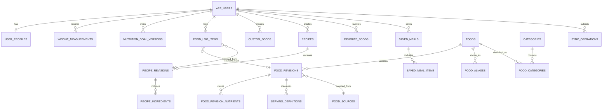

# NUTRASA — Database Schema Specification

**Version:** 1.0 — Draft for architecture approval  
**Date:** 2026-10-13  
**Target path:** [docs/02-architecture/database-schema.md](database-schema.md)\
**Status:** DATABASE DESIGN ONLY. No migrations, SQL DDL, seed data, or implementation authorized.  
**Architecture decision (approved):** React Native / Expo + TypeScript; Firebase Authentication; local Fastify / Node.js API; local PostgreSQL; Expo SQLite for offline-tolerant mobile operation. Target service cost Rp0 during local development. Deployment/hosting later.

> Read together with: [food-database-spec.md](food-database-spec.md), [food-logging-spec.md](../03-features/food-logging-spec.md), [offline-sync-spec.md](offline-sync-spec.md), [NUTRASA_NUTRITION_ENGINE_SPEC_v0.5.md](nutrition-engine-spec.md), [onboarding-spec.md](../01-design/onboarding-spec.md), [dashboard-spec.md](../03-features/dashboard-spec.md), [progress-spec.md](../03-features/progress-spec.md), [profile-spec.md](../03-features/profile-spec.md), [auth-spec.md](../03-features/auth-spec.md), [system-architecture.md](system-architecture.md), and [zero-cost-architecture.md](zero-cost-architecture.md). Product and clinical policies that remain open are **not** silently approved by this database proposal.

## 1. Guiding principles

1. PostgreSQL is the **canonical cloud/server database**, despite running locally in development; SQLite is a **per-device replica/cache and outbox**, not an alternative server authority.
2. Firebase Auth owns credentials and authentication identities. PostgreSQL owns application account/profile/domain data. Use verified Firebase **UID**, not email, as the stable account link.
3. The mobile app never connects to PostgreSQL directly or contains PostgreSQL credentials or Firebase Admin credentials; Fastify verifies Firebase ID tokens and authorizes every private operation.
4. **Published food/recipe versions are immutable**; user journal rows contain **nutrition snapshots**, so catalog edits never retroactively change logs.
5. Food nutrients can be unknown (`NULL`) and must not be stored as zero by default. Report daily partial coverage alongside totals.
6. Preserve journal local date and time zone independently of UTC timestamps; distinguish actual consumed date from when data was created.
7. All client-originated mutable records use client-generated UUIDs, server revisions, soft-delete/tombstone semantics where needed, and idempotent sync operations.
8. Use integrity constraints, transactions, uniqueness rules, provenance and access controls. Avoid premature partitioning, redundant aggregate tables and numerous speculative columns.
9. Prefer bounded, auditable domain tables rather than a single giant JSON document; use JSONB only for versioned snapshots, controlled metadata, and operation payloads.
10. Include lifecycle and retention design for account deletion, but defer legal retention windows until reviewed.

## 2. Authority and database boundaries

| Data domain | Authority | SQLite behavior | Access |
|---|---|---|---|
| Firebase credentials / linked identity | Firebase Auth | SDK-managed secure persistence | Firebase provider; server verifies token |
| App account / body profile / onboarding completion | PostgreSQL | Private per-account cache; onboarding draft locally | Owner only |
| Published foods / revisions / portion definitions | PostgreSQL | Read-only published-version cache | Readable by authorized app users; admin changes only |
| Custom foods / recipes | PostgreSQL | Per-owner cache and pending edits | Owner only unless separate curated publish process |
| Food logs / snapshots | PostgreSQL | Local-first write and outbox | Owner only |
| Weight measurements | PostgreSQL | Local-first write and outbox | Owner only |
| Active nutrition targets / target history | PostgreSQL | Cached verified targets; offline candidates **not** active | Server-authoritative |
| Favorites / saved meals | PostgreSQL | Pending offline mutations | Owner only |
| Recent foods / daily rollups | Derived | Can compute/cache locally | No canonical table required for v1 |
| Import/editorial audits | PostgreSQL | Not replicated to public clients | Admin/reviewer only |

**Database isolation:** `owner_user_id` should reference an internal `app_users.id` UUID. `app_users.firebase_uid` is UNIQUE and immutable once established; lookup of internal user from verified token occurs on server. Never trust an owner identifier supplied by the client.

## 3. Data type and naming conventions

- SQL identifiers: `snake_case`, plural table names (`food_revisions`), singular `*_id` references.
- Primary key: UUID for mutable app/domain entities, including client-created offline entities; generated on client using appropriate secure UUID generation, or server for server-only entities.
- Timestamps: `timestamptz` UTC semantics for `created_at`, `updated_at`, `deleted_at`, `published_at`.
- Journal day: PostgreSQL `date` (user-selected local calendar date); timezone: valid IANA string (`Asia/Jakarta` etc.). No automatic derivation of journal day from server UTC.
- Measurements: `numeric` / DECIMAL (not binary float) for authoritative nutrition/portion quantities. **Proposed** `numeric(14,5)` for amounts and nutrients; precision/ranges to verify from sample data and calculator. Currency is outside v1.
- Enumerations: controlled `text` + `CHECK` or lookup tables; select DDL strategy during migration design. Avoid database enum proliferation that makes evolution costly.
- Soft deletions on synchronized owner-created entities use nullable `deleted_at` and monotonically increasing `revision`. Hard deletion is reserved for privacy cleanup with retention review.
- Nutrition units are **fixed per nutrient key**, not arbitrary user-selected strings; serving `basis_unit` is `g` or `ml`, and unit conversion is food-specific.
- Use `jsonb` for immutable nutrient snapshots and outbox payloads, with strict request/schema validation at API boundary. JSONB is **not** a substitute for searchable food composition data.
- FK delete actions must be explicit in migration review. Do not cascade-delete immutable historical snapshots as a side effect of catalog archiving.

## 4. Canonical nutrient contract (11 agreed metrics)

Canonical key names align with [food-database-spec.md](food-database-spec.md), the corrected [food-logging-spec.md](../03-features/food-logging-spec.md) pseudotype, [nutrition-engine-spec.md](nutrition-engine-spec.md), and [api-contract.md](api-contract.md). The documentation merge reconciled aliases only; calculation semantics and technical contract sign-off are unchanged.

| nutrient_code | Label | Unit | Core required for curated public publishing |
|---|---|---|---|
| `energy_kcal` | Kalori | kcal | YES |
| `protein_g` | Protein | g | YES |
| `carbohydrate_g` | Karbohidrat | g | YES |
| `fat_g` | Lemak total | g | YES |
| `fiber_g` | Serat | g | NO |
| `total_sugar_g` | Gula total | g | NO |
| `saturated_fat_g` | Lemak jenuh | g | NO |
| `trans_fat_g` | Lemak trans | g | NO |
| `cholesterol_mg` | Kolesterol | mg | NO |
| `sodium_mg` | Natrium | mg | NO |
| `potassium_mg` | Kalium | mg | NO |

**Nutrient data rules:**

- In `food_revision_nutrients`, a missing nutrient row or `value = NULL` means unknown; `0` means known zero only. Favor one row for each of 11 keys per published revision for simple coverage auditing, though sparse storage can be used if semantics stay explicit.
- In `food_log_items.nutrient_snapshot`, serialize all 11 canonical keys; unknown values are explicit `null`. Source energy is not overwritten by simple 4/4/9 computation.
- Nutrition basis for revision is a defined amount such as `100 g` or `100 ml`; do not assume mass and volume are interchangeable. `snapshot` is for the **actual logged quantity**, not per-100g.
- Preserve precision in calculations and round for display. A partially known daily total is the sum of known amounts **plus coverage metadata**; never label it fully complete.
- Source-specific carbohydrate definitions, detection limits and sodium-versus-salt distinction are captured as provenance/qualifiers; avoid pretending the 11 keys capture every analytical nuance.

## 5. Logical relationship diagram

Diagram emphasizes conceptual relationships, not all FK columns or ownership scopes. Offline recipe references and private food composition need additional constraints described below.

## 6. Server table catalog — P0 MVP core

**Release priority caveat:** recipe/favorite entities below remain design drafts; their inclusion here does not establish P0. Their release timing is OPEN under O-18 in the decision register. Preserve modeling details for review without starting migrations.

**Notation:** `PK` primary key; `FK` foreign key; `UQ` unique; `NN` not null; `?` nullable; `v` server revision; indexes are proposals to validate against queries. Fields marked `PROPOSED` are technical designs, not newly approved product behaviors.

### 6.1 Identity, profile and onboarding

**`app_users`** — app-level owner identity (never stores passwords)

| Column | Constraint / description |
|---|---|
| `id` | UUID PK |
| `firebase_uid` | text NN UQ; derived only from verified Firebase ID token |
| `email_display` | text ?; nonauthoritative, may change/hidden |
| `email_verified_cache` | boolean ?; refreshed from trusted claims/provider |
| `account_status` | text NN; proposed ACTIVE / PENDING_DELETION / DELETED |
| `created_at`, `updated_at`, `deleted_at` | timestamps |

**`user_profiles`** — one mutable profile per user

| Column | Constraint / description |
|---|---|
| `user_id` | UUID PK FK -> app_users |
| `date_of_birth` | date ?; only if retained under approved data-minimization policy |
| `height_cm` | numeric ? positive |
| `activity_level` | text ?; exactly one input per approved onboarding |
| `calculation_parameter` | text ?; physiological formula input distinct from gender identity; privacy review |
| `goal_type` | text ?; CUT / MAINTAIN / BULK / MUSCLE_GAIN / etc. as product-approved |
| `target_weight_kg` | numeric ?; required for eligible CUT/BULK **when submitting onboarding** |
| `body_type_visual` | text ?; no calculation effect |
| `onboarding_status` | text NN; NOT_STARTED / IN_PROGRESS / COMPLETED / LOG_ONLY / NEEDS_REVIEW per state machine |
| `onboarding_completed_at` | timestamptz ? |
| `profile_revision` | bigint NN default 1 |
| `updated_at` | timestamptz NN |

**Important:** current weight is derived from `weight_measurements` and is not stored as an independently editable second source of truth. The first onboarding weight is the first weight measurement. Name/username remain optional; keep them in an optional `display_name` profile column **only if** needed; username uniqueness has not been approved.

**`privacy_acknowledgements`** (proposed legal audit, minimal)

`id` UUID PK; `user_id` FK; `notice_version` text NN; `ack_type` text NN; `acknowledged_at` timestamptz NN; `source_surface` text ?. Do not mistake the presence of a row for legally adequate consent; basis, wording, withdrawal, and retention require legal review.

**Auth provider linking** should remain under Firebase Authentication. Avoid redundant provider account tables in PostgreSQL unless audit requirements demand them later.

### 6.2 Food catalogue and sources

**`food_sources`** — traceable external or curated source

`id` UUID PK; `name` text NN; `source_type` text NN (`TKPI`, `PANGANKU`, `LABEL`, `CURATED_RECIPE`, `THIRD_PARTY` etc.); `edition` text ?; `source_reference` text ?; `url` text ?; `accessed_at` date ?; `permission_status` text NN (`UNVERIFIED`, `ALLOWED`, `RESTRICTED`, `DENIED`); `permission_notes` text ?; `created_at` timestamptz NN.

**`foods`** — stable curated food identity (one dish can have multiple revisions)

`id` UUID PK; `canonical_name` text NN; `normalized_name` text NN; `food_type` text NN; `region` text ?; `preparation_description` text ?; `publication_status` text NN; `current_published_revision_id` UUID ?; `created_at`, `updated_at`, `archived_at` timestamps. `current_published_revision_id` must belong to the same food; enforce via application transaction and a suitable composite FK/DB check strategy at DDL design. Do not delete food identities referenced by logs.

**`food_revisions`** — immutable once published

`id` UUID PK; `food_id` FK NN; `revision_number` integer NN positive; `basis_quantity` numeric NN positive (typically 100); `basis_unit` text NN (`g`/`ml`); `composition_definition` text ? (e.g. cooked/edible portion); `source_id` FK ?; `source_food_code` text ?; `source_method` text NN; `carbohydrate_definition` text ?; `quality_status` text NN; `content_hash` text ?; `created_at`, `published_at` timestamps; UNIQUE `(food_id, revision_number)`.

After publish: forbid UPDATE to nutrient values / serving conversions and factual revision content. A correction creates a new revision. Fields needed for editorial state should reside in separate review records or a controlled pre-publication workflow.

**`food_revision_nutrients`** — one row per nutrient per food revision

`food_revision_id` UUID FK NN; `nutrient_code` text NN; `value` numeric ? (nonnegative when known); `value_qualifier` text ? (`BELOW_DETECTION` etc.); `data_method` text ?; `source_detail` text ?; composite PK `(food_revision_id, nutrient_code)`; CHECK nutrient code one of 11 approved keys, unit defined by code not duplicated per row.

**`serving_definitions`** — revision-bound, food-specific user portions

`id` UUID PK; `food_revision_id` FK NN; `label` text NN (`1 potong`, `1 centong`, `1 mangkuk`); `unit_kind` text NN (`MASS`, `VOLUME`, `HOUSEHOLD`); `base_quantity` numeric NN positive; `base_unit` text NN `g`/`ml` matching food revision basis (or explicitly mapped if compatible); `method` text ?; `review_status` text NN; `sort_order` integer NN default 0; UNIQUE `(food_revision_id, label)` (after normalization convention). A 1-centong definition does **not** apply globally to other foods.

**`categories`** — hierarchical taxonomy

`id` UUID PK; `parent_id` UUID FK -> categories ?; `name` text NN; `slug` text NN UQ; `sort_order` integer NN; `is_active` boolean NN; prevent hierarchy cycles at application/DB validation layer.

**`food_categories`** — many-to-many

`food_id` UUID FK NN; `category_id` UUID FK NN; `is_primary` boolean NN default false; composite PK `(food_id, category_id)`; enforce at most one primary category per food (partial unique index proposal).

**`food_aliases`** — Indonesian synonyms and regional labels

`id` UUID PK; `food_id` FK NN; `alias` text NN; `normalized_alias` text NN; `locale` text ?; UNIQUE `(food_id, normalized_alias)`.

### 6.3 User food / recipe / quick-access records

**`custom_foods`** — user-private food identity

`id` UUID PK; `owner_user_id` UUID FK NN; `name` text NN; `description` text ?; `current_revision_id` UUID ?; `revision` bigint NN; `created_at`, `updated_at`, `deleted_at` timestamps; owner-scoped search only. Custom food may remain draft if core nutrients missing; logging requires valid core inputs as agreed in feature spec pending final confirmation.

**`custom_food_revisions`** — immutable versions of private entries

`id` UUID PK; `custom_food_id` FK NN; `revision_number` integer NN; `basis_quantity` numeric NN positive; `basis_unit` text NN; `nutrient_values` jsonb NN (11-key validated object, unknown => null); `source_notes` text ?; `created_at` timestamptz NN; UNIQUE `(custom_food_id, revision_number)`. Explicitly enforce that revision belongs to same owner. A custom food never automatically becomes public.

**`recipes`** — identity for private recipes

`id` UUID PK; `owner_user_id` UUID FK NN; `name` text NN; `current_revision_id` UUID ?; `revision` bigint NN; `created_at`, `updated_at`, `deleted_at` timestamps. If public curated recipes are introduced, use a separate explicit editorial process—not owner flag changes with automatic publication.

**`recipe_revisions`** — immutable prepared-recipe composition

`id` UUID PK; `recipe_id` UUID FK NN; `revision_number` integer NN; `yield_quantity` numeric NN positive; `yield_unit` text NN (`g`/`ml`), or explicitly documented count/portion yield convertible to known final mass; `nutrient_total_snapshot` jsonb NN; `calculation_method` text NN; `assumptions` jsonb ?; `created_at` timestamptz NN; UNIQUE `(recipe_id, revision_number)`.

**`recipe_ingredients`** — ingredient-level snapshot inputs

`id` UUID PK; `recipe_revision_id` UUID FK NN; `position` integer NN; `source_kind` text NN (`PUBLIC_FOOD`, `CUSTOM_FOOD`, `RECIPE` if nested recipes later approved); `source_revision_id` UUID NN; `entered_quantity` numeric NN positive; `entered_unit` text NN; `resolved_base_quantity` numeric NN positive; `ingredient_nutrients_snapshot` jsonb NN; `retention_yield_notes` text ?; UNIQUE `(recipe_revision_id, position)`. Because one ID can refer to different version tables, verify source type + FK in domain service/DB trigger or split nullable source FKs with an XOR CHECK during DDL; **never accept an unconstrained polymorphic ID alone in production**. For MVP, reject cyclic/nested recipe references if nested recipes are not approved.

**`favorite_foods`** — private references

`id` UUID PK; `owner_user_id` FK NN; `source_kind` text NN; `source_id` UUID NN; `created_at`, `deleted_at` timestamps; unique active `(owner_user_id, source_kind, source_id)`; source ownership/publication enforced by API.

**`saved_meals`**, **`saved_meal_items`** — reusable copy meal templates

- `saved_meals`: `id` UUID PK; `owner_user_id` FK NN; `name` text NN; `revision` bigint NN; `created_at`, `updated_at`, `deleted_at`.
- `saved_meal_items`: `id` UUID PK; `saved_meal_id` FK NN; `position` integer NN; `display_name_snapshot` text NN; `source_kind` text NN; `source_revision_id` UUID ?; `quantity` numeric NN positive; `unit_descriptor` text NN; `nutrient_snapshot` jsonb NN; UNIQUE `(saved_meal_id, position)`.

`recent_foods` need not be a server table: derive from recent journal entries locally/server-side ordered by effective event time, per user.

### 6.4 Food diary, weights, targets and preferences

**`food_log_items`** — one row per recorded food portion (avoid unnecessary parent daily-log table)

| Column | Constraint / description |
|---|---|
| `id` | UUID PK, client-generated for idempotent create |
| `owner_user_id` | UUID FK NN; set from authenticated session |
| `journal_date` | date NN; explicitly selected day |
| `journal_time_zone` | text NN; IANA zone saved at time of entry |
| `meal_type` | text NN; BREAKFAST / LUNCH / DINNER / SNACK |
| `source_kind` | text NN; PUBLIC_FOOD / CUSTOM_FOOD / RECIPE / QUICK_ADD (QUICK_ADD pending approval) |
| `source_revision_id` | UUID ?; snapshot-based entries may remain readable after source archived |
| `display_name_snapshot` | text NN |
| `entered_quantity`, `entered_unit` | numeric NN positive + text NN |
| `resolved_base_quantity`, `resolved_base_unit` | numeric ? + text ?; mandatory when conversion is known |
| `nutrient_snapshot` | jsonb NN with all 11 canonical keys and nullable values |
| `nutrition_data_quality` | text NN; FULL / PARTIAL / UNKNOWN_CORE (latter generally not loggable for curated foods) |
| `revision` | bigint NN >= 1, optimistic concurrency version |
| `created_at`, `updated_at`, `deleted_at` | timestamps |

**Data integrity:** log snapshot created in same logical operation as serving conversion; when user edits amount, create a new item revision/snapshot or update under optimistic lock and keep an audit trail as required. Archives never cascade into logs. In-place editing of a log is allowed, but published food revisions remain unchanged. `source_revision_id` FK strategy must cover public/custom/recipe independently (split nullable FKs with XOR check or typed link service with strong validation).

**`journal_day_states`** — explicit user completion flag

`owner_user_id` FK NN; `journal_date` date NN; `completion_status` text NN (`OPEN` / `CONFIRMED_COMPLETE`); `revision` bigint NN; `updated_at` timestamptz NN; composite PK `(owner_user_id, journal_date)`. No row is a valid state: `NO_LOGS`, **not** a statement of 0 calories. Completion is independent of nutrient completeness.

**`weight_measurements`** — timestamped weigh-ins (also supports onboarding initial weight)

`id` UUID PK; `owner_user_id` UUID FK NN; `measured_at` timestamptz NN; `journal_date` date NN; `journal_time_zone` text NN; `weight_kg` numeric NN > 0; `source` text NN (`ONBOARDING` / `MANUAL`); `revision` bigint NN; `created_at`, `updated_at`, `deleted_at` timestamps. Multiple per day allowed in storage; Progress display policy (latest/average/etc.) still needs owner approval.

**`nutrition_goal_versions`** — versioned, server-authoritative targets

| Column | Constraint / description |
|---|---|
| `id` | UUID PK |
| `owner_user_id` | UUID FK NN |
| `goal_mode` | text NN AUTO / MANUAL / LOG_ONLY (LOG_ONLY could also be absence of active version; pick one policy before DDL) |
| `effective_from`, `effective_to` | timestamptz NN / ? (or journal dates by explicit agreed effective policy) |
| `calculation_status` | text NN READY / NEEDS_REVIEW / UNSUPPORTED / etc. |
| `target_energy_kcal`, `target_protein_g`, `target_carbohydrate_g`, `target_fat_g` | numeric ?; `NULL` for unsupported/unavailable, never fabricated |
| `supplementary_targets` | jsonb ? with value, comparator/semantics, unit and policy version |
| `calculation_input_snapshot` | jsonb NN; limited data necessary to reproduce target, protect sensitive profile values |
| `formula_version`, `policy_version` | text NN; reviewed versions, not invisible constants |
| `trigger_reason` | text NN (`ONBOARDING` / `WEIGHT_UPDATE` / `PROFILE_UPDATE` / `MANUAL_EDIT`) |
| `source_weight_measurement_id` | UUID FK ? |
| `created_at`, `activated_at` | timestamptz NN / ? |

**Invariant:** at most one active READY target per user at a point in time; no overlapping active validity ranges (implement with range/exclusion or transactional serialization in DDL). Historical calculations and target comparisons must use the version effective on the relevant journal date according to an explicitly approved effective-date rule. On auto-recalculate: validate on server **before** activation, preserve old version, and do not activate `NEEDS_REVIEW` or unsupported results. Existing manual targets must not be silently replaced; precedence rule awaits owner approval.

**`user_preferences`** — one row per user

`user_id` UUID PK FK; `language_code` text NN default `id`; `preferred_weight_unit` text NN default `kg`; `preferred_food_unit` text ?; `time_zone` text NN default `Asia/Jakarta` only when expressly selected/confirmed; `reminder_preferences` jsonb ? (future optional); `updated_at` timestamptz NN. Do not assume all Indonesians are in Asia/Jakarta.

### 6.5 Sync and audit infrastructure

**`sync_operations`** — server-side durable idempotency receipt / per-user mutation journal

`operation_id` UUID PK; `owner_user_id` UUID FK NN; `device_id` UUID NN; `entity_type` text NN; `entity_id` UUID NN; `operation_kind` text NN CREATE / UPDATE / DELETE; `base_revision` bigint ?; `payload_digest` text NN; `result_status` text NN (`APPLIED` / `REJECTED` / `CONFLICT`); `response_summary` jsonb ?; `processed_at` timestamptz NN; UNIQUE `(owner_user_id, operation_id)` redundant if globally unique but helpful conceptually. A retried operation with same ID and **different** payload digest must reject, not replay arbitrary changes.

**`change_feed`** (proposed sync delta source)

`cursor` bigint generated monotonic PK; `owner_user_id` FK NN; `entity_type` text NN; `entity_id` UUID NN; `entity_revision` bigint NN; `change_type` text NN; `changed_at` timestamptz NN; `payload_ref` jsonb ? (do not write unrestricted sensitive copies). Indexed `(owner_user_id, cursor)`. Must record mutation and feed event **in one DB transaction**; gaps in cursors are permissible. Define retention + full-resync strategy before API approval.

**`catalog_import_batches`** and **`catalog_reviews`** (minimum editorial traceability, can start as controlled import workflow): batch ID/source/checksum/operator/import status and review record referencing candidate food revision/reviewer/decision/time/reason. Privileged editor records must never be visible in mobile public catalog.

**Deletion workflow** (proposed): `account_deletion_requests` with `id`, `user_id`, `requested_at`, `status`, `completed_at` and minimal audit metadata, coordinated with Firebase account deletion and server/local tombstoning. This is not a substitute for a legally reviewed retention schedule.

## 7. PostgreSQL relationships, constraints and proposed indexes

- `app_users(firebase_uid)` UNIQUE; verify Firebase UID using Firebase Admin on API; no username/email as identity key.
- `food_revisions(food_id, revision_number)` UNIQUE; published content immutable.
- `food_revision_nutrients(food_revision_id, nutrient_code)` PK; nonnegative known values and controlled qualifiers.
- `food_categories(food_id, category_id)` PK; one primary category maximum, category-cycle prevention.
- `food_aliases(normalized_alias)` index for search; `foods(normalized_name)` searchable. PostgreSQL `pg_trgm` and full-text index are **candidates**, to test on real Indonesian names; no additional hosted search vendor for MVP.
- `food_log_items(owner_user_id, journal_date, meal_type)` composite index excluding soft-deleted rows; `food_log_items(owner_user_id, updated_at)` if needed for account history queries.
- `weight_measurements(owner_user_id, measured_at desc)` partial index for non-deleted records.
- `nutrition_goal_versions(owner_user_id, effective_from desc)` and DB rule against overlapping active periods.
- `favorite_foods(owner_user_id, source_kind, source_id)` unique active row.
- `sync_operations(owner_user_id, processed_at)`, `change_feed(owner_user_id, cursor)`.
- Use owner-qualified predicates on **all** user data queries, not merely endpoint middleware. Cross-tenant joins must never leak other owners.
- Limit `ON DELETE CASCADE` to private subordinate entities explicitly reviewed; use RESTRICT/archival for published catalog dependencies and controlled purge orchestration for account deletion.

## 8. Transaction and consistency contracts

| Operation | Required atomic behavior |
|---|---|
| Create public food revision | Revision + nutrients + servings + review state inserted together; publish only after quality/license gates |
| Add food log | Validate owner/source/serving; write item snapshot + revision and sync receipt/change event atomically |
| Copy meal | Create **new** log IDs for each copied item; snapshots preserve copied nutrition, dates set to destination; source unchanged |
| Create/edit recipe | Store immutable revision + ingredient snapshots + yield + aggregate total as one consistent unit |
| Record weight | Save weight event; enqueue/evaluate target recomputation; do not activate unsafe target |
| Auto-activate valid target | Close prior effective interval and activate verified new version in transaction; prevent overlap and race |
| Soft delete offline record | Apply tombstone, increment revision, append change feed; no resurrection by delayed stale update |
| Replay operation | Return prior outcome when operation ID and digest match; reject payload mismatch |
| Account deletion | Block sync/write operations, then coordinated server/Firebase/local cleanup; restore requires explicit policy |

**Sync concurrency:** updates/deletes provide `base_revision`. Server applies only if current revision matches; conflict response includes safe current revision metadata (and permitted field snapshots) for resolution. Last-write-wins across all entities is **not** the default. Server timestamps alone cannot determine user intent on offline devices.

## 9. Local SQLite schema responsibilities (separate from server DDL)

SQLite should be intentionally narrower than PostgreSQL; avoid blindly duplicating every editorial table:

1. `local_identity_scope` / user partition info tied to authenticated Firebase UID or internal user mapping; all local private records partitioned by account and protected per security plan.
2. `cached_food_revisions`, `cached_servings`, `cached_food_search_index`, `catalog_sync_metadata` (published, versioned, selectively cached data).
3. `local_food_log_items`, `local_weight_measurements`, `local_favorites`, `local_custom_foods`, `local_recipes`, `local_journal_day_states` (record owner, revision, dirty status, tombstone).
4. `cached_user_profile`, `cached_goal_versions` for verified server state; `onboarding_draft` account-scoped and locally stored until submission (as previously agreed).
5. `sync_outbox`: operation ID, account, entity ID/type, operation, payload, base revision, attempt count, retry-after, created timestamp, status and last error (redacted).
6. `sync_cursor`: server change feed cursor per account; `sync_inbox_staging` if necessary for atomic delta application.

A local user action and its outbox entry should commit in the **same SQLite transaction**. UI reads from the local model. When server acknowledges, reconcile server version/changes and update local sync status in one transaction. Database schema migrations for SQLite require explicit versioning and tests.

**Security caveat:** plain SQLite is not automatically encrypted at rest. Define device-security expectations, retention, backup behavior, sensitive field minimization and whether SQLCipher/development builds are required **before** claiming secure offline storage. Never place Firebase Admin credentials or PostgreSQL connection strings in the app.

## 10. Query requirements driving schema (to verify with EXPLAIN later)

| User action | Logical query / index expectation |
|---|---|
| Browse category → ayam | food_categories joins foods.current published revision, ordered relevance/name |
| Search `ayam bakar`, `ayam krispi` | normalized food names + aliases, scoped to published public + current user's private foods |
| Food details / servings | one food revision + 11 nutrient values + serving definitions + provenance summary |
| Day dashboard | all non-deleted food_log_items for user/day, then calculate known nutrient totals and coverage |
| Progress 7/30/90 days | aggregate journal-date consumption, exclude no-log days from averages; join relevant historical goals |
| Copy meal | select source meal/day, create new destination IDs and snapshots |
| Weight history | ordered measurements, with duplicate-day display selection policy to be approved |
| Goal calculation history | active/previous version by effective period; no silent retroactive comparison |
| Sync pull | changes by authenticated user and cursor; paginated |
| Admin food QA | draft/review queue, source permission, completeness and abnormal-value flags |

For 100–500 curated foods, normalized PostgreSQL with sensible indexes is sufficient; do not add Elasticsearch, Redis, sharding, partitions or materialized summary tables without measured need.

## 11. Data migration, seed and zero-cost environment plan

- **Local:** PostgreSQL developer instance, Fastify developer API, Firebase project already owned; no paid services required for ordinary local tests within respective quotas.
- **Environments:** separate development/production configuration and Firebase projects before real users; avoid using real users' data in development. Seed only sourced, legally usable and reviewed catalogue entries.
- **Migration plan:** number/version schema migrations, enforce review in Git, run against disposable development DB, test downgrade/restore strategy; **do not generate migrations until API contract approved**.
- **Import pipeline:** CSV/structured source → provenance/permission check → parse/normalize → nutrient/unit validation → reviewer approval → immutable published revision. Demo fixtures MUST be clearly fake; no fabricated nutrition data passed off as verified.
- **Backups:** include local PostgreSQL backup/restore rehearsal. A free local install does not eliminate data-loss risk.
- **Scale path:** move PostgreSQL to managed hosting and Fastify to an appropriate host without changing mobile contract; migrate database with tested export/import, secrets and environment setup; verify latency, connection pooling, backup and privacy policy prior to beta.

## 12. Security, legal and clinical review gates

**Security review required:** Firebase Admin SDK token verification (issuer, audience, expiry), token refresh, ownership checks, privileged editorial endpoints, API validation/limits, database least privilege, secret handling, safe error responses, client secure storage, account switch and offline pending records.

**Legal/privacy review required:** data bodily/health-related classification under Indonesian law, notice and legal basis, consent where needed, deletion/retention, transfer/hosting geography, data portability and third-party food data licensing. Do not assume an import is permitted merely because its source is public.

**Clinical/nutrition review required:** formula and safety parameters, eligibility, target activation, nutrient thresholds, recipe retention/yield assumptions, meaning and completeness of 11 nutrients. Schema stores formula/policy versions and review status, but **does not itself validate a recommendation clinically**.

## 13. Quality assurance / test matrix

| ID | Scenario | Acceptance criteria |
|---|---|---|
| DB-01 | Duplicate Firebase UID | Second account insertion rejected |
| DB-02 | User changes email/Apple hides email | App identity remains same verified UID |
| DB-03 | Food publication missing protein | Refused public publish; may remain draft |
| DB-04 | Potassium absent | Represented NULL, not zero |
| DB-05 | Known 0 trans fat | Zero retained distinct from unknown |
| DB-06 | Food serving 1 centong varies across foods | Food revision-specific conversions differ correctly |
| DB-07 | 150 g from 100 g basis | Snapshot scales by 1.5 without intermediate rounding |
| DB-08 | 100 ml source, 100 g input | No unsupported conversion without density/measurement |
| DB-09 | Update published ayam nutrition | New revision; old revision unchanged |
| DB-10 | Update a food already logged | Logged nutrition snapshot unchanged |
| DB-11 | Recipe ingredient missing nutrient | Recipe flags partial for that nutrient |
| DB-12 | Two users share name of custom food | Records remain isolated by owner |
| DB-13 | Search returns user's private foods | Never returns another user's private items |
| DB-14 | Copy yesterday's lunch twice | Two intentional distinct sets of log UUIDs |
| DB-15 | Same offline operation retried | No duplicate log; same result returned |
| DB-16 | Same idempotency ID, different payload | Reject with conflict/error |
| DB-17 | Concurrent edit from two devices | One succeeds; stale base revision conflicts |
| DB-18 | Soft-deleted record receives delayed update | No silent resurrection |
| DB-19 | Calendar empty day | NO_LOGS, not zero-energy inference |
| DB-20 | Day with partial nutrient values | Known sum and coverage warning shown |
| DB-21 | User logs around UTC midnight | `journal_date` follows selected local day |
| DB-22 | Historical goal changed today | Past date still resolves prior target |
| DB-23 | Two auto-recalculations race | No overlapping active targets |
| DB-24 | Offline candidate target | Not active until approved server validation |
| DB-25 | Login user A then user B on same device | B cannot read A's local/server records |
| DB-26 | Unauthorized food log ID | 403/404 without leaking private details |
| DB-27 | Account delete with pending offline events | Old events cannot restore deleted account |
| DB-28 | Missing source license permission | Import/publish blocked pending review |
| DB-29 | Recipe circular dependency | Rejected if nested recipes enabled; absent if not enabled |
| DB-30 | Database migration replay | Idempotent migration status; no accidental data loss |
| DB-31 | Sync cursor after retention cutoff | Safe full resync path without dropping unsent outbox |
| DB-32 | Unverified email account | Backend follows separately approved restriction policy |

## 14. Decision register (explicitly NOT approved by this document)

| ID | Decision required | Suggested default | Dependency |
|---|---|---|---|
| D-01 | `nutrition_goal_versions` validity: instant vs local-date effective boundary | Effective local journal date with timezone policy; avoid retroactive mutation | Product + nutrition engine |
| D-02 | AUTO versus MANUAL precedence on new weigh-in | Recalculate automatically, preserve manual target unless explicit switch | Product + clinical |
| D-03 | `NEEDS_REVIEW` goal and unsupported status model | No active unsupported numeric target; maintain clear status | Clinical + product |
| D-04 | Exact age/physiology/body data retention | Minimum sufficient, consider age calculation and update cadence | Legal + clinical |
| D-05 | Firebase unverified email: which writes blocked? | Local onboarding allowed; final cloud profile policy pending | Auth + product + security |
| D-06 | Food revision nutrients as rows vs per-revision columns | Rows for traceability and coverage | Data engineering |
| D-07 | Recipe ingredient typed FKs and nesting | Multiple typed FKs; no recursive recipes in MVP | Food logging |
| D-08 | Household portion definitions and confidence | Require conversion/review per specific food revision | Food database |
| D-09 | Multiple weights on same day in progress | Store all; choose latest for chart with clear UI label | Progress |
| D-10 | `journal_day_states` explicit completion requirement | User-controlled confirmation, optional | Dashboard + progress |
| D-11 | Offline encrypted-at-rest requirement and backup policy | Security review before production | Security + Expo |
| D-12 | Sync feed retention, pagination, and conflict UX | Revision checks + feed + safe full resync | API contract |
| D-13 | Custom food nutrition minimum for logging | Require all four core values if custom logged | Food logging |
| D-14 | Privileged importer/reviewer implementation | CLI import initially with controlled admin service | Operations |
| D-15 | Account data deletion retention and reactivation | Block writes + coordinated purge; review retention | Legal + security |
| D-16 | API validation/schema library and query/migration tooling | Decide after API contract; no dependency install yet | Tech lead |
| D-17 | Status of third-party live foods vs cached catalog | Keep separated and respect license caching restrictions | Legal + sourcing |
| D-18 | Quick Add, reminder, AI and premium records | No production tables unless approved for MVP | Product |

## 15. Acceptance criteria for database design approval

- [ ] All agreed user journeys map to tables/fields or documented derived calculations.
- [ ] Each private entity has explicit owner control and auth boundary.
- [ ] Data source, food versions, 11 nutrients, nullable semantics and portion bases are unambiguous.
- [ ] All food log variants (curated/custom/recipe) have robust source-reference integrity and immutable nutrition snapshot.
- [ ] Onboarding -> profile -> initial weight -> goal version relationships can be created transactionally.
- [ ] Automatic weight-triggered target recalculation does not overwrite manual goals or history without approved policy.
- [ ] Local SQLite cache/outbox is distinguished from authoritative PostgreSQL state.
- [ ] Sync idempotency, concurrency, deletion and change-feed contracts have agreed failure handling.
- [ ] Queries for home, catalog, progress and profile are demonstrably supported.
- [ ] Clinical, legal, licensing and security review items remain visibly open.
- [ ] **API contract reviewed and signed off before implementing schema migrations or backend endpoints.**

## 16. Next document: [api-contract.md](api-contract.md)

Review the existing draft [docs/02-architecture/api-contract.md](api-contract.md) **next**, not migrations. Check parity for: `GET /me`, onboarding submission, account/profile/weight/goal management, catalog browse/search/details, private foods/recipes, food log operations, favorite/saved meals, daily dashboard and progress reads, sync push/pull, and account deletion; plus Firebase token verification, scope-based authorization, request/response field contracts, canonical nutrient object, pagination, error codes, idempotency, `base_revision`, and timestamp/date semantics. Recipe/favorite release timing remains OPEN under O-18.

**Before coding:** reconcile D-01 through D-18 by owner decisions/review, align conflicting historical nutrient pseudotype names, then lock migration strategy. This document is an implementation-ready **design draft**, not authorization to write production code or claim clinical/legal validation.
